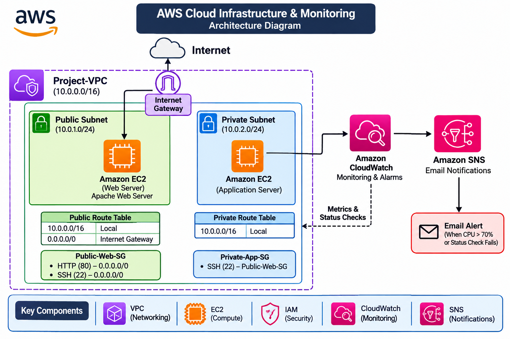

# AWS Cloud Infrastructure & Monitoring with CloudWatch and SNS

## Project Overview

This project demonstrates how to design, deploy, and monitor a basic AWS cloud infrastructure using Amazon VPC, EC2, IAM, Amazon CloudWatch, and Amazon SNS.

The infrastructure consists of a custom VPC with public and private subnets, EC2 instances, security groups, an Internet Gateway, and separate route tables.

Amazon CloudWatch monitors EC2 CPU utilization and instance status checks. When CPU utilization exceeds the configured threshold, CloudWatch triggers an alarm and Amazon SNS sends an email notification.

The project focuses on cloud networking, infrastructure deployment, monitoring, alerting, and basic AWS security practices.

## Objectives

- Design a custom AWS VPC.
- Configure public and private subnets.
- Configure Internet Gateway and route tables.
- Deploy EC2 instances in separate subnets.
- Configure security groups and IAM roles.
- Deploy an Apache web server on Amazon Linux 2023.
- Monitor EC2 CPU utilization using CloudWatch.
- Configure EC2 status check monitoring.
- Integrate CloudWatch alarms with Amazon SNS.
- Test CPU alerts and verify email notifications.

## Architecture Diagram



### Architecture Flow

1. A custom VPC provides network isolation.
2. The public subnet hosts the public EC2 web server.
3. The private subnet hosts a private EC2 instance.
4. The Internet Gateway provides internet connectivity to the public subnet through its route table.
5. Security groups control inbound and outbound traffic.
6. Apache serves the website from the public EC2 instance.
7. CloudWatch monitors EC2 CPU utilization and status checks.
8. When CPU utilization exceeds 70%, CloudWatch changes the alarm state to ALARM.
9. Amazon SNS sends an email notification to the subscribed email address.

## AWS Services Used

| AWS Service | Purpose |
|---|---|
| Amazon VPC | Isolated virtual network |
| Public Subnet | Hosts the public web server |
| Private Subnet | Hosts the private EC2 instance |
| Internet Gateway | Internet connectivity for public subnet |
| Route Tables | Control network traffic routing |
| Security Groups | Instance-level network security |
| Amazon EC2 | Compute infrastructure |
| Amazon Linux 2023 | EC2 operating system |
| Apache HTTP Server | Web server |
| AWS IAM | Identity and access management |
| Amazon CloudWatch | Monitoring and alarms |
| Amazon SNS | Email notifications |

## Infrastructure Configuration

### 1. VPC Configuration

- VPC Name: `Project-VPC`
- VPC ID: `vpc-0f4068103f55507ff`
- IPv4 CIDR: `10.0.0.0/16`
- AWS Region: `ap-south-1` (Asia Pacific – Mumbai)

### 2. Subnet Configuration

| Subnet | CIDR Block | Availability Zone | Purpose |
|---|---|---|---|
| Public-Subnet-1 | 10.0.1.0/24 | ap-south-1a | Public web server |
| Private-Subnet-1 | 10.0.2.0/24 | ap-south-1b | Private application server |

### 3. Internet Gateway

- Name: `Project-IGW`
- Attached to: `Project-VPC`
- Provides internet connectivity to resources in the public subnet through the public route table.

### 4. Route Table Configuration

**Public Route Table — Public-RT**

| Destination | Target |
|---|---|
| 10.0.0.0/16 | Local |
| 0.0.0.0/0 | Internet Gateway |

Associated with `Public-Subnet-1`.

**Private Route Table — Private-RT**

| Destination | Target |
|---|---|
| 10.0.0.0/16 | Local |

Associated with `Private-Subnet-1`.

The private subnet does not have a NAT Gateway or internet route in this implementation.

### 5. Security Groups

**Public-Web-SG**

- HTTP — TCP port 80 — `0.0.0.0/0`
- SSH — TCP port 22 — configured for administrative access during setup.

**Private-App-SG**

- SSH — TCP port 22 — source configured as `Public-Web-SG`.

Note: Review and restrict SSH access before using this infrastructure in a production environment. Do not leave SSH open to the entire internet.

### 6. EC2 Instances

**Public Web Server**

- Name: `Web-Server-Public`
- Instance ID: `i-0d7f244a66a5bff1f`
- Instance Type: `t3.micro`
- Operating System: Amazon Linux 2023
- Private IP: `10.0.1.171`
- Subnet: `Public-Subnet-1`
- Security Group: `Public-Web-SG`
- IAM Role: `EC2-Monitoring-Role`

**Private Application Server**

- Name: `App-Server-Private`
- Instance ID: `i-0b65a30ec173a98e6`
- Instance Type: `t3.micro`
- Operating System: Amazon Linux 2023
- Subnet: `Private-Subnet-1`
- Security Group: `Private-App-SG`

## Web Server Configuration

Apache HTTP Server was installed on the public EC2 instance running Amazon Linux 2023.

Installation command:

```bash
sudo dnf install -y httpd
```

Start Apache:

```bash
sudo systemctl start httpd
```

Enable Apache at system startup:

```bash
sudo systemctl enable httpd
```

Verify Apache:

```bash
sudo systemctl status httpd
```

Test the web server locally:

```bash
curl -I http://localhost
```

A successful HTTP response confirms that the Apache web server is responding.

The website was made accessible through the public IPv4 address using HTTP port 80.

Sample webpage:

```html
<h1>AWS Cloud Infrastructure Project</h1>
<p>Public Web Server Running Successfully!</p>
```

## IAM Configuration

An IAM role named `EC2-Monitoring-Role` was created for EC2 instances.

Attached policies:

- `AmazonSSMManagedInstanceCore`
- `CloudWatchAgentServerPolicy`

The role demonstrates how AWS IAM permissions can be assigned to EC2 instances instead of relying on long-term access keys.

## CloudWatch Monitoring

Two CloudWatch alarms were configured for the public EC2 instance.

### 1. High CPU Utilization Alarm

Alarm Name: `Web-Server-High-CPU`

Configuration:

| Setting | Value |
|---|---|
| Namespace | AWS/EC2 |
| Metric | CPUUtilization |
| Statistic | Average |
| Period | 5 minutes |
| Threshold | Greater than 70% |
| Evaluation | 1 out of 1 datapoints |
| Missing Data | Treat as missing |
| Notification | Amazon SNS |

When CPU utilization exceeds 70%, the alarm changes to ALARM and triggers the configured SNS notification action.

### 2. EC2 Status Check Alarm

Alarm Name: `Web-Server-Status-Check-Failed`

Configuration:

| Setting | Value |
|---|---|
| Namespace | AWS/EC2 |
| Metric | StatusCheckFailed |
| Statistic | Maximum |
| Period | 5 minutes |
| Threshold | Greater than or equal to 1 |
| Evaluation | 1 out of 1 datapoints |
| Notification | Amazon SNS |

This alarm monitors EC2 instance status checks and is configured to notify through SNS when a status check failure is detected.

The alarm was configured; an actual EC2 status-check failure was not deliberately induced.

## Amazon SNS Email Notifications

An SNS topic named `StandardEC2-Health-Alerts` was created.

Configuration:

- Protocol: Email
- Topic: `StandardEC2-Health-Alerts`
- Email subscription: Configured and confirmed
- CloudWatch alarm actions: Connected to the SNS topic

When the CPU alarm enters ALARM, SNS delivers an email notification to the confirmed subscriber.

## Testing and Validation

### CPU Stress Testing

The `stress-ng` utility was installed on the public EC2 instance.

Installation:

```bash
sudo dnf install -y stress-ng
```

CPU stress test:

```bash
stress-ng --cpu 2 --cpu-load 100 --timeout 7m --metrics-brief
```

This command generates CPU workload using two CPU workers for seven minutes.

### Test Results

| Test | Expected Result | Result |
|---|---|---|
| Apache web server | HTTP 200 response | Successful |
| Website accessibility | Website opens in browser | Successful |
| CPU stress test | CPU utilization increases | Successful |
| CloudWatch CPU alarm | Alarm enters ALARM | Successful |
| SNS integration | SNS action executes | Successful |
| Email notification | Email received | Successful |
| Alarm recovery | Alarm returns to OK | Successful |
| Status check alarm | Alarm configured | Successful |

### CPU Alarm History

CloudWatch alarm history confirmed:

- Alarm transitioned from OK to ALARM.
- SNS action was successfully executed.
- Alarm subsequently returned to OK after CPU utilization decreased.

The CPU stress test and email notification were successfully demonstrated.

## Project Screenshots

All implementation screenshots are stored in the `screenshots/` directory.

### Network Infrastructure

| Screenshot | File |
|---|---|
| VPC configuration | `01-vpc-details.png` |
| Public subnet | `02-public-subnet.png` |
| Private subnet | `03-private-subnet.png` |
| Internet Gateway | `04-internet-gateway.png` |
| Public route table | `05-public-route-table.png` |
| Private route table | `06-private-route-table.png` |

### Security and Compute

| Screenshot | File |
|---|---|
| Public security group | `07-public-security-group.png` |
| Private security group | `08-private-security-group.png` |
| IAM role and policies | `09-iam-role.png` |
| EC2 instances | `10-ec2-instances.png` |
| Public EC2 details | `11-public-ec2-details.png` |
| Private EC2 details | `12-private-ec2-details.png` |
| Apache service running | `13-web-server-running.png` |
| Website in browser | `14-website-browser.png` |

### Monitoring and Notifications

| Screenshot | File |
|---|---|
| SNS topic | `15-sns-topic.png` |
| SNS email subscription | `16-sns-email-subscription.png` |
| CPU alarm configuration | `17-cpu-alarm-configuration.png` |
| Status check alarm | `18-status-check-alarm.png` |
| CPU alarm in ALARM state | `19-cpu-alarm-triggered.png` |
| CloudWatch alarm history | `20-cpu-alarm-history.png` |
| SNS email received | `21-sns-email-received.png` |
| EC2 instances stopped | `22-ec2-stopped.png` |

## Cost Management and Cleanup

Cost management was considered throughout the project.

- Used `t3.micro` EC2 instances.
- Avoided NAT Gateway deployment.
- Used an auto-assigned public IPv4 address instead of an Elastic IP.
- Stopped EC2 instances when they were not required.
- Avoided leaving test workloads running unnecessarily.
- Kept track of CloudWatch and EBS storage resources.

Important: Stopping EC2 instances stops compute usage charges, but EBS volumes and certain monitoring resources may continue to incur charges. Always check AWS Billing and Cost Explorer.

After completing documentation, unused resources should be terminated or deleted carefully.

## Key Learnings

Through this project, I gained practical experience with:

- AWS VPC and subnet design.
- Public and private network architecture.
- Internet Gateway and route table configuration.
- EC2 instance deployment.
- Security group configuration.
- IAM roles and managed policies.
- Apache web server installation and validation.
- CloudWatch metrics and alarms.
- SNS email notification integration.
- CPU stress testing and alarm validation.
- AWS resource lifecycle and cost management.

## Future Improvements

- Automate infrastructure provisioning using Terraform.
- Implement a CI/CD pipeline for web server deployment.
- Configure centralized logging and dashboards.
- Add automated remediation using AWS Systems Manager.
- Improve private subnet connectivity using appropriate private access mechanisms.
- Implement stricter least-privilege security policies.

## Conclusion

This project demonstrates a practical AWS infrastructure deployment with network segmentation, EC2 hosting, monitoring, and email-based alerting.

By integrating Amazon CloudWatch with Amazon SNS, the infrastructure can detect high CPU utilization and notify an administrator through email.

The project provided hands-on experience with fundamental AWS infrastructure, monitoring, security, and operational practices.

---

**Author:** Ayush Sharma  
**GitHub:** https://github.com/ayushsharma81  
**Project:** AWS Cloud Infrastructure & Monitoring  
**Region:** Asia Pacific (Mumbai) — `ap-south-1`
